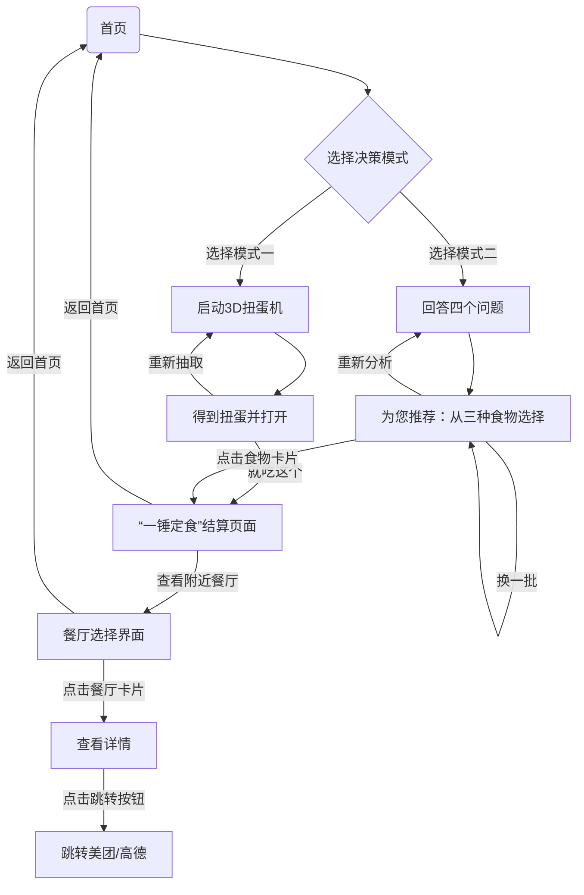

# BiteDecide 需求规格说明书

## 一、项目概述和设计背景

该软件名为“一锤定食”，面向当下以大学生为主的年轻人群体。根据调研结果，仅有不到 8% 的年轻人不存在对“今天吃什么”的纠结，并且有超过 64% 每天都会纠结，可见“今天吃什么”诚然是一个当下年轻人的普遍顾虑。同时根据我们的调查，产生纠结的原因主要是“没胃口”或者“选择太多”。为此，我们准备了两个方案以帮助用户做出抉择：一是采用“扭蛋机”的方式随机决定，二是通过向用户询问情绪、情感倾向相关问题，分析后向用户推荐一系列可能适合用户的食物，帮助做出选择。无论通过哪种方式推荐出的食物，最终可以向用户推荐筛选周围的优质餐厅。

---

## 二、功能需求规格

### FR-00 首页数据获取

首页读取并展示当前时间、位置、天气信息，美观的同时便于为下面的饮食倾向分析提供数据

---

### FR-01 内置全量美食库

系统内置美食库，尽可能包含所有常见美食，并且将常见美食分为8个大类:

- `hotpot`：锅物和麻辣烫类
- `noodle`：粉面汤水类
- `rice`：盖饭和中式快餐
- `fastfood`：西式快餐和炸物
- `snack`：街头小吃和地方风味
- `bbq`：烧烤和夜宵江湖菜
- `porridge`：温和养胃和粥品
- `light`：轻食和甜品下午茶

每种食物包含以下属性：(每个属性可能有多种取值)

- `name`：唯一标识符和菜名，作为检索附近餐厅的关键词
- `category`：所属大类(`hotpot noodle rice fastfood snack bbq porridge light`)
- `visual`：美食图片+一句诱人描述
- `temperature`：温度属性(`hot(滚烫，如火锅) warm(正常热菜，如盖饭) cool(凉，如凉面) cold(冰，如冰淇淋)`)
- `mealTime`：适合时段 (`breakfast(早餐4-11点) lunch(中餐11-14点) dinner(晚餐17-21点) tea(下午茶14-17点) supper(夜宵21-4点)`)
- `moodTags`：契合的情绪状态 (`stressed(高压) tired(疲惫) reward(开心) casual(平常)`)
- `flavor`：味道类型（`spicy(香辣) savory(咸鲜) sour(酸甜) mild(清淡)`）
- `texture`：口感形态（`soup(汤水) dry(干拌) crispy(酥脆) soft(软糯)`）
- `scale`：就餐规格（`snack(小吃) simple(简餐) hearty(正餐) feast(大餐)`）

---

### FR-02 模式一：3D扭蛋机随机决定

用户启动 3D 扭蛋机得到一个扭蛋（每大类扭蛋颜色不同），随后扭蛋自动打开，展示出随机抽取出的食物对应的卡片，上面是食物的图片以及描述。抽取后可以选择

- “重新抽取”：随后的抽取过程将排除刚刚抽出的食物并重新执行
- “就吃这个”：随后出现结算界面，上面显示“一锤定食：XX”，下面可以选择“返回首页”或“查看附近餐厅”

---

### FR-03 模式二：问答分析决定

针对用户今天的状态，每种食物会有对应的评分。首先通过系统时间以及天气得到时间、温度，然后影响得分（如天气在10度以下则`temperature`为 `hot` 的食物+10分，为`cool` 的食物-10分) 。同时针对食物的四个属性`moodTags` `flavor` `texture` `scale`，设计四类问题库。每次将从问题库中随机抽取，用户回答后得到四类倾向，进而影响相应的食物得分（注意每个回答的界面要有返回上一题的按钮）。最终“为您推荐”界面提供得分排名前三顺位的食物卡片，同时有“重新分析”和“换一批”的按钮，用户可以从三个卡片中做出选择，若没有满意的可以选择”换一批“，顺延到下面三顺位的食物卡片，以此类推。用户点击满意的食物卡片出现结算界面，上面显示“一锤定食：XX”，下面可以选择“返回首页”或“查看附近餐厅”。

---

### FR-04 附近餐厅推荐

决定“今天吃什么”后，用户可以选择”查看附近餐厅“进入附近餐厅推荐，并且推荐页也依然显示决定吃的是什么，同时可在该推荐页更改位置。系统调用高德地图API检索附近有该食物的餐厅，随后展示餐厅卡片，卡片展示餐厅高德评分、距离、人均价格、餐厅图片，点开可查看详情，上面增加一些详细信息，附带高德和美团的跳转链接。默认卡片按评分排序，也可更改排序方式。

---

## 三、用户交互流程

---

## 四、非功能需求

### NFR-01 多端适配

应用需支持手机端竖屏触控操作以及PC端操作，不能出现排版问题。双端都需要较好的人机交互体验。

### NFR-02 动态效果与响应速度

3D扭蛋机需要流畅精美的动效，最好达到60FPS，同时要保持较快的响应速度。“换一批”等按钮也要保持较快的响应速度。

### NFR-03 数据获取失败与降级处理

当获取天气、定位与时间失败时，需要进行降级处理，首页不展示未获取的数据，食物偏好默认按天气适宜 `warm` ，时间适宜 `dinner` 的方式处理。当定位获取失败时，进入餐厅推荐页后提示“没能获取你的位置，请告诉我你在哪里”，让用户提供自己的位置。

### NFR-04 数据与逻辑解耦

食物库与问题库单独存储，避免与逻辑部分耦合。

### NFR-05 人机交互体验

采用带来食欲的视觉界面设计，减少用户需要执行的冗余操作。

### NFR-06 极端情况处理

若通过重新抽选扭蛋或“换一批”导致食物库已经全部被遍历，则重置随机池继续抽取或循环回到第一批。
